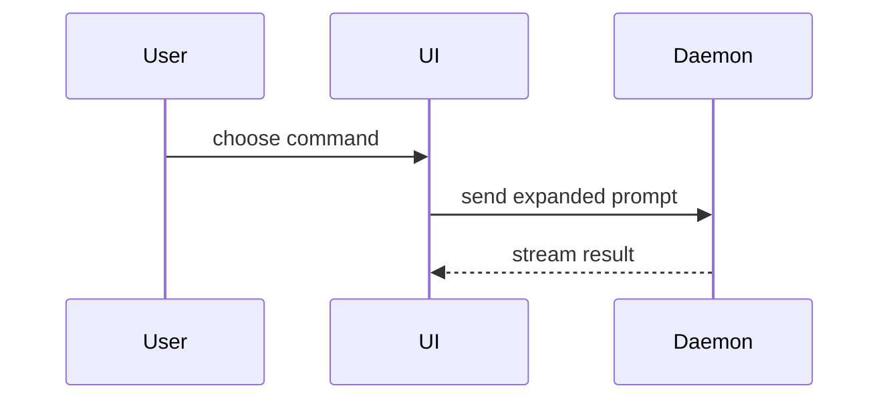

Help the user understand the current topic of conversation visually. Skip the preamble and keep prose brief. Pick the smallest view that makes the key point clear.

Use Markdown for code sketches and tables. Use Mermaid when labeled nodes and edges fully explain the structure.

- Show logic or an algorithm as pseudocode:

```text
on(save)
  if content is unchanged
    return cached result
  write new content
  return fresh result
```

- Show runtime control flow as a call tree:

```text
submitForm
  createSession
    persistPrompt
    launchAgent
  navigateToSession
```

- Show UI structure as a component tree, including state and module boundaries that matter:

```tsx
<SessionPage> (apps/example/src/routes/session.tsx)
  useSessionEvents()
  <SessionToolbar>
    <RunSkillButton> (packages/ui)
```

- Show file responsibility or a broad refactor as a shallow file tree:

```text
src/
├── commands/       # parses user actions
├── sessions/       # owns session state
└── transport/      # sends API requests
```

- Show component interaction, control flow, or data flow with Mermaid:



- Use `diff` when the point is what changes and the surrounding shape already exists. Match the diff shape to the topic.

For a component change:

```diff
 <SessionPage>
   useSessionEvents()
   <SessionToolbar>
+    <RunSkillButton />
   <SessionTimeline>
+    <SkillResultCard />
```

For a file-layout change:

```diff
 src/
 ├── commands/
+│   └── show-me.ts       # expands the slash command
 ├── sessions/
-└── transport.ts
+└── transport/
+    ├── client.ts
+    └── stream.ts
```

For a call-tree or call-stack change:

```diff
 submitForm
   createSession
     persistPrompt
+    expandSkillMention
     launchAgent
-  navigateToSession
+  navigateToSession
+    subscribeToEvents
```

For a state or control-flow change:

```diff
 on(save)
-  write content
+  if content is unchanged
+    return cached result
+  write new content
+  invalidate cache
```

- Show the whole block when most of it is new, when omitted context would hide ownership or order, or when the user needs a copyable target shape:

```ts
function expandSkill(command: string): string {
  const skillName = command.slice(1);
  return `use the ${skillName} skill`;
}
```

- For charts, simulations, maps, UI mockups, or concepts that need richer graphics, load the available `visualize` skill (`visualize:visualize` in a namespaced skill list). Follow its composition, interaction, theme, and accessibility guidance. Load it only when the graphic materially improves the explanation.

- Use the output format supported by the current host:

  - In T3 Code, write a complete, self-contained HTML document. Check it with `html_preview`, then publish it with `html_render` before the final reply. Use T3's rendering contract and theme variables. Keep controls local unless the host supplies an API for the requested action.
  - In a host that supports the `visualize` inline output contract, follow that contract.
  - If `visualize` is unavailable, use the code views above or the host's inline HTML tools. If inline HTML is also unavailable, write one portable HTML file and open it for the user. Use real labels and data, match the product when relevant, and support desktop and mobile.

- Build a requested standalone file or project change in its target location. Use inline graphics to explain or explore a design when that is the user's request.

### guidance

Place each visual next to the short text it supports. Keep only the calls, files, props, states, and boundaries needed to answer the user's current question or the options to resolve the current discussion point.

You may use one of these, you may use several, it is unlikely you will use all of them. Use your judgement and don't overwhelm the user.
